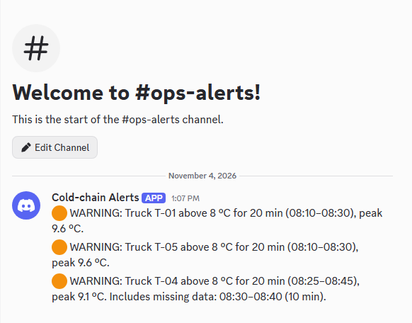
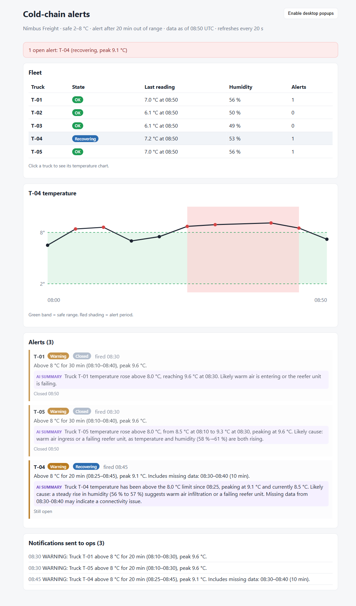

# Cold-Chain Alerting Engine — Nimbus Freight

Alerts the ops team **once per real, sustained temperature problem on a truck**: not on every warm reading, not on brief blips, and not over and over for the same problem. It stays correct when readings go missing or arrive out of order.

- **Design and reasoning:** [SOLUTION_DESIGN.md](SOLUTION_DESIGN.md) · every assumption with its reason: [docs/ASSUMPTIONS.md](docs/ASSUMPTIONS.md) · build log: [PROGRESS.md](PROGRESS.md)



*The three alerts from the seed data, delivered to a Discord `#ops-alerts` channel by the webhook notifier.*



*The ops dashboard (FastAPI + React): fleet states, T-04's chart with the 2–8 °C band and the alert period shaded, and alerts with reasons and labelled AI summaries.*

## What it decides on the seed data

| Truck | What happens | Result |
|---|---|---|
| T-01 | Above 8 °C 08:10–08:40, peak 9.6 °C | **Alert** at 08:30, closed at 08:50 |
| T-02 | One reading of 8.9 °C | No alert: a single-reading blip |
| T-03 | Climbs to 7.0 °C | No alert: never out of range |
| T-04 | Above 8 °C 08:25–08:45, **08:35 reading missing** | **Alert** at 08:45 (20 min by timestamps); the starter code missed it |
| T-05 | Same as T-01 but **shuffled in the file** | **Alert** at 08:30 after sorting; the starter code missed it |

Three alerts, three notifications, and a stated reason for every truck, including why T-02 and T-03 did *not* alert.

## How it works

```
readings ─► Loader (validate, flag impossible temps, dedupe, SORT by sensor time)
         ─► State machine per truck: OK → SUSPECT → ALERT → RECOVERING → OK
         ─► alerts + notifications (fixed ids, so each is sent once)
         ─► CLI report · Discord/Slack webhook · optional AI wording
```

- **Alert** after **20 min** out of the **2–8 °C** range, measured from sensor timestamps.
- **Recovered** only after **10 min back in range**, seen by 2 readings. A single dip doesn't reset or close anything.
- **Gaps** of up to 15 min are bridged and reported in the alert. A longer silence gets its own "sensor silent" notification.
- **No repeats:** after the first alert, an update goes out only if the temperature **isn't improving** (checked every 10 min), and once more if it turns **Critical** (60 min, or ≥ 11 °C).
- **The rules decide; the AI only words the message.** Every number in an AI summary is checked against the alert, and if anything is off the plain message is sent.

## Run it

Needs Python 3.12 (Windows PowerShell shown).

```powershell
python -m venv .venv
.\.venv\Scripts\python -m pip install -r requirements.txt -r requirements-dev.txt

# Report on the seed data: what I'd alert on, and why
.\.venv\Scripts\python -m backend.cli

# Same as JSON, or try another limit
.\.venv\Scripts\python -m backend.cli --json
.\.venv\Scripts\python -m backend.cli --alert-after-min 25

# Any readings file; --now sets the evaluation time (shows silent sensors)
.\.venv\Scripts\python -m backend.cli path\to\readings.json --now 2026-07-20T09:30:00
```

### Send alerts to Discord (or Slack)

1. In Discord: your server → channel `#ops-alerts` → ⚙️ Edit Channel → Integrations → Webhooks → New Webhook → **Copy Webhook URL**.
2. `Copy-Item .env.example .env`, then set `ALERT_WEBHOOK_URL=<the URL>` in `.env`. The URL is a secret: `.env` is git-ignored.
3. Run:

```powershell
.\.venv\Scripts\python -m backend.cli --send        # plain rule-based messages
.\.venv\Scripts\python -m backend.cli --ai --send   # AI-worded, with the facts underneath
```

Without a URL, `--send` prints the messages to the console instead.

### AI summaries (optional)

Set `LLM_PROVIDER=groq` (and optionally `LLM_FALLBACK_PROVIDER=gemini`) with the matching API key and model in `.env`. The default, `mock`, needs no key. Only the alert's numbers are sent to the LLM. It has 5 s in total, and on any timeout, error or invented number the plain message is used. Example from the seed data (Groq):

> Truck T-01 temperature rose above 8.0 °C, reaching 9.6 °C with a rising trend and increasing humidity from 58 % to 61 %. Likely a warm air ingress or a failing reefer unit.

### Dashboard + API

```powershell
cd frontend; npm install; npm run build; cd ..
.\.venv\Scripts\python -m uvicorn backend.main:app --port 8000
# open http://127.0.0.1:8000   (API docs: http://127.0.0.1:8000/docs)
```

| Endpoint | Purpose |
|---|---|
| `GET /health` | Liveness |
| `GET /api/report` | Everything: trucks, alerts, notifications (with AI summaries), data quality |
| `GET /api/trucks`, `GET /api/trucks/{id}` | Fleet states; one truck's readings and alerts (for the chart) |
| `GET /api/alerts?status=open\|recovering\|closed` | Alerts with reasons |
| `POST /api/readings` | Upload `{"readings": [...], "replace": false}`. Re-evaluates and pushes new notifications once. Max 5,000 readings / 2 MB. |
| `POST /api/reset` | Reload the seed data (demo) |

Sent notification ids are stored through SQLAlchemy (PostgreSQL via `DATABASE_URL`, otherwise a local SQLite file), so a restart never resends. The page refreshes every 20 s and shows a banner (and an optional desktop popup) when a new alert arrives.

### Ask an AI assistant (MCP)

`backend/mcp_server.py` is a **read-only** MCP server, registered in `.mcp.json` as `cold-chain`. In Claude Code, ask *"which trucks are in trouble right now?"*: it calls `get_fleet_status` / `get_open_alerts` and answers from the real data. No tool can close or silence an alert. The backup demo needs no AI at all: `npx @modelcontextprotocol/inspector .venv\Scripts\python -m backend.mcp_server`.

## Tests

**183 automated tests:** 133 unit, 48 integration (including 3 frontend) and 2 end-to-end in real Chrome. 97% Python coverage, plus live checks against Discord and Groq. Details, and what each level proves: **[docs/TESTING.md](docs/TESTING.md)**.

```powershell
.\.venv\Scripts\python -m pytest                       # unit + integration
cd frontend; npm run typecheck; npm test; cd ..        # UI
.\.venv\Scripts\python -m pytest tests_e2e --browser-channel chrome --no-cov   # end-to-end
.\.venv\Scripts\ruff check .; .\.venv\Scripts\pip-audit -r requirements.txt
```

Tests never make real network calls: the webhook is forced off and the LLM to mock. They caught 4 real bugs, including the HTTP library logging the secret webhook URL.

## Project layout

```
backend/engine/   loader, config (all thresholds), state machine — pure Python, no I/O
backend/notify/   console + webhook senders, send-once dispatcher, payload
backend/ai/       facts sent to the LLM, Groq/Gemini/mock clients, answer check
backend/cli.py    command-line report, --send, --ai
backend/report.py JSON form of the results (shared by CLI, API and MCP)
backend/api.py    FastAPI app (backend/main.py starts it); backend/store.py = send-once table
backend/mcp_server.py  read-only MCP tools for AI assistants
frontend/src/     React + TypeScript dashboard (SVG chart, no chart library)
tests/            unit + integration (pytest)   tests_e2e/  browser end-to-end
docs/             assumptions, testing, screenshots
```

## Known limitations

- **Batch, not streaming:** v1 evaluates a whole file. Live ingestion with late-data handling is designed (SOLUTION_DESIGN.md §4) but not built.
- **The API keeps readings in memory** (the send-once ids are in the database). A restart reloads the seed file, and a multi-instance deployment would need readings in the database too.
- **CLI `--send` remembers sent ids only for that run** (the API uses the database).
- **One profile for the whole fleet (2–8 °C):** the data has no cargo type. Per-cargo profiles are future work.
- **Sensor-fault readings** (< −40 / > 50 °C) are flagged and ignored but don't notify anyone yet.
- **No login on the dashboard or API.** Fine for a local demo; a real deployment needs authentication (e.g. Cloud Run IAM or an identity proxy).
- The MCP server reads the seed file, not readings uploaded to the running API.
